<!-- † † † † † † † † † † †   s a y s x n t s   † † † † † † † † † † † -->

 

  

<em>† Construindo soluções robustas, performáticas e modernas — com elegância †</em>

 

  

**Software Engineer no Bradesco** e estudante de **Ciência da Computação na Impacta**. 
No dia a dia, mantenho e monitoro **sistemas internos**, construo **integrações e automações** 
e uso **dados** para deixar fluxos operacionais mais rápidos e eficientes.

Antes disso, na **Wise System**, evoluí a plataforma **SIGO** direto no código: debug em produção, 
**scripts Python** para automação de testes e triagem, **documentação de APIs REST** e dashboards em tempo real. 
A base veio da **ETEC**, programando jogos digitais — onde a lógica virou paixão.

† &nbsp; backend &nbsp; † &nbsp; automação &nbsp; † &nbsp; arquitetura de sistemas &nbsp; † &nbsp; código limpo &nbsp; †

 

<table>
  <tr>
    <td align="center" width="120"><b>out 2025</b> atual</td>
    <td><b>† Desenvolvedor de Soluções</b> &nbsp;·&nbsp; <code>Bradesco</code> 
      Estágio · Barueri, SP · Híbrido — Patrimônio 
      Manutenção e monitoramento de sistemas internos, integrações e automação de processos, 
      análise de dados para otimização de fluxos e eficiência operacional.</td>
  </tr>
  <tr>
    <td align="center"><b>set 2025</b> out 2025</td>
    <td><b>† Desenvolvedor Web</b> &nbsp;·&nbsp; <code>Wise System</code> 
      C# · ASP.NET · Python · APIs REST 
      Sustentação e evolução da plataforma SIGO: diagnóstico e correção de falhas no código-fonte, 
      logs estruturados, automação de testes e triagem em Python, docs de APIs e dashboards.</td>
  </tr>
  <tr>
    <td align="center"><b>mai 2025</b> set 2025</td>
    <td><b>† Suporte Técnico</b> &nbsp;·&nbsp; <code>Wise System</code> 
      Suporte a clientes do SIGO (eSocial, GRO, PGR, PCMSO, LTCAT), instalação, configuração, 
      integrações e migração de sistemas.</td>
  </tr>
  <tr>
    <td align="center"><b>2024</b> 2027</td>
    <td><b>† Bacharelado em Ciência da Computação</b> &nbsp;·&nbsp; <code>Impacta Tecnologia</code></td>
  </tr>
  <tr>
    <td align="center"><b>2021</b> 2023</td>
    <td><b>† Técnico em Programação de Jogos Digitais</b> &nbsp;·&nbsp; <code>ETEC — Centro Paula Souza</code></td>
  </tr>
</table>

 

<code>† LINGUAGENS †</code>  

  

<code>† FRAMEWORKS †</code>  

  

<code>† DADOS & INFRA †</code>  

 

<table align="center">
  <tr>
    <td align="center" width="50%">
      <h3>† Auth Service</h3>
      
API de autenticação com JWT, conteinerizada em Docker (FastAPI + PostgreSQL).

      

        
        
        
        
      

      
    </td>
    <td align="center" width="50%">
      <h3>† Blog API</h3>
      
API RESTful em C#/.NET Core com EF Core, SQLite e Swagger.

      

        
        
        
      

      
    </td>
  </tr>
  <tr>
    <td align="center" width="50%">
      <h3>† Encurtador de Links</h3>
      
API REST em TypeScript e Fastify para encurtar links, com expiração e estatísticas.

      

        
        
      

      
    </td>
    <td align="center" width="50%">
      <h3>† Fórum Design Patterns</h3>
      
Fórum de discussão com nove padrões de projeto GoF: servidor Flask + cliente Qt.

      

        
        
        
      

      
    </td>
  </tr>
</table>

 

 

<table>
  <tr><td>†</td><td><b>AWS Cloud Foundations</b></td><td>Amazon Web Services</td><td>mai 2026</td></tr>
  <tr><td>†</td><td><b>Git & GitHub Essentials</b></td><td>GitHub</td><td>jul 2025</td></tr>
  <tr><td>†</td><td><b>Python para Data Science</b></td><td>Alura</td><td>mar 2025</td></tr>
  <tr><td>†</td><td><b>Java</b></td><td>Alura</td><td>fev 2025</td></tr>
  <tr><td>†</td><td><b>Lógica de Programação</b></td><td>Fundação Bradesco</td><td>jan 2025</td></tr>
  <tr><td>†</td><td><b>Power BI</b></td><td>Senai São Paulo</td><td>out 2024</td></tr>
</table>

 

